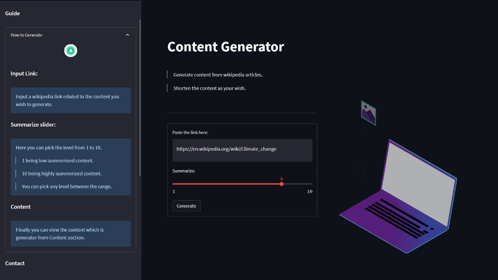

# Wikipedia Summarizer

A Streamlit web app that turns any Wikipedia article into a shorter summary, with a slider to control how much it shortens.

Built in 2022 as a college project, before LLM tools were mainstream, using classic NLP (spaCy) instead of an AI model.

## What it does

1. Paste a Wikipedia article link.
2. Pick a summarization level from 1 to 10.
3. Click **Generate**. The app fetches the article, summarizes it section by section, and keeps the section headings so the result stays readable.

## How it works

- **Fetching:** the `wikipedia` library pulls the article content from the link.
- **Cleaning:** the text is split into sections using Wikipedia's `== Heading ==` markers. Short pieces are treated as headings, and processing stops at "See also".
- **Summarizing (extractive):** for each section, spaCy (`en_core_web_sm`) tokenizes the text. Words are scored by frequency, ignoring stop words and punctuation, and each sentence is scored by the words it contains. The top-scoring sentences are kept, with the slider deciding what share of sentences survives.
- **UI:** Streamlit, with Lottie animations, a how-to guide in the sidebar and a contact form.

## Tech stack

Python · Streamlit · spaCy · wikipedia · streamlit-lottie

## Run it locally

```bash
git clone https://github.com/itshashi7/wiki_summarizer.git
cd wiki_summarizer
pip install -r requirements.txt
python -m spacy download en_core_web_sm
streamlit run website.py
```

## Project structure

| File | Purpose |
|---|---|
| `website.py` | Streamlit UI: link input, slider, layout and contact form |
| `main.py` | Fetches the article, splits it into sections and writes the summary |
| `summarizer.py` | Frequency-based extractive summarization with spaCy |
| `style.css` | Styling for the contact form |

## Screenshot

<!-- Add a screenshot: save it as docs/screenshot.png and uncomment the line below -->
<!--  -->

## What I'd improve now

- Replace frequency scoring with an LLM or a transformer model for more natural summaries.
- Show the summary directly on the page instead of writing it to `output.txt`.
- Cache fetched articles and add error handling for invalid links.

## Author

**Hashim Khan N** · [Portfolio](https://itshashi7.github.io/hashi-portfolio/) · [LinkedIn](https://linkedin.com/in/hashim-khan-7b07b3223)
